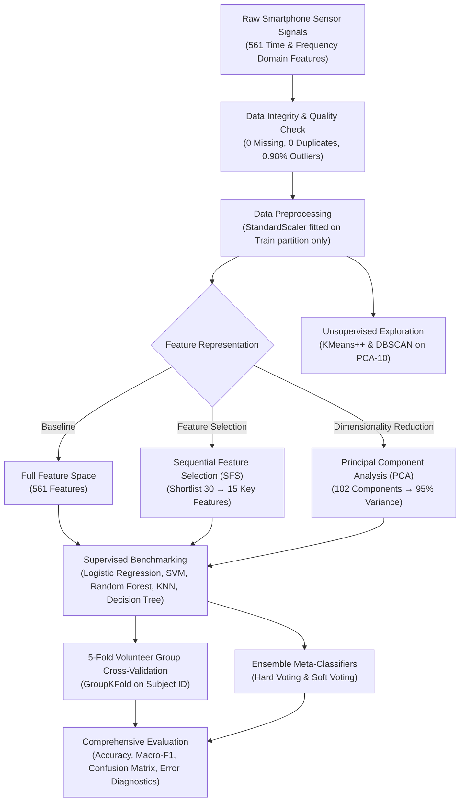

# Human Activity Recognition: Complete Machine Learning Pipeline

[](https://www.python.org/)
[](https://scikit-learn.org/)
[](LICENSE)

**Course Project:** Practical Applications of AI & Machine Learning (PAIML Lab)  
**Project Title:** End-to-End Human Activity Recognition Pipeline  
**Students:** Kartikeya Jain & Ayush Yadav  
**Course Instructors:** Dr. Pruthwik Mishra & Dr. Praveen Chandaliya  

---

## 📌 Executive Summary

This repository contains an end-to-end Machine Learning pipeline for **Human Activity Recognition (HAR)** using tri-axial smartphone accelerometer and gyroscope signals. The project investigates feature selection, dimensionality reduction, unsupervised structure discovery, supervised classification, and voting ensembles across **10,299 sensor observations**.

Our top-performing model is a **Soft Voting Ensemble (Logistic Regression + SVM + Random Forest)**, achieving **95.96% test accuracy** and **0.9588 macro F1-score**. Furthermore, by applying **Principal Component Analysis (PCA)**, we compressed the 561-dimensional sensor space down to **102 components (81.8% compression)** while retaining **93.76% accuracy** with an RBF Support Vector Machine trained in just **0.67 seconds**.

---

## 🏗️ System Architecture & Workflow



---

## 📊 Dataset Overview

- **Source:** UCI Smartphone Human Activity Recognition (HAR) Dataset.
- **Hardware:** Waist-mounted Samsung Galaxy S II smartphone capturing tri-axial linear acceleration and angular velocity at 50 Hz.
- **Volunteers:** 30 human subjects (split into 21 training subjects and 9 test subjects).
- **Scale:**
  - **Total Samples:** 10,299 rows (Training: 7,352 rows, Test: 2,947 rows).
  - **Feature Dimension:** 561 continuous variables spanning time-domain and frequency-domain statistics (means, standard deviations, FFT energy, entropy, autoregression coefficients).
- **Target Classes (6 Balanced Activities):**
  1. `WALKING` (Dynamic)
  2. `WALKING_UPSTAIRS` (Dynamic)
  3. `WALKING_DOWNSTAIRS` (Dynamic)
  4. `SITTING` (Static)
  5. `STANDING` (Static)
  6. `LAYING` (Static)

---

## 🔬 Key Pipeline Components

### 1. Exploratory Data Analysis & Multicollinearity
- **Data Quality:** Verified that all 561 sensor columns are numeric floats, with **0 missing values** and **0 duplicate samples**. Outliers exceeding $\pm 3\sigma$ represent only $0.98\%$ of entries.
- **Severe Multicollinearity:** Sensor channels derived from identical axes exhibit heavy collinearity:
  - **23.3% of feature pairs (36,564 pairs)** have absolute Pearson correlation $|r| > 0.70$.
  - **5.2% of feature pairs (8,206 pairs)** have $|r| > 0.90$.
  - This empirical finding directly motivates feature selection and PCA.

### 2. Unsupervised Learning (Cluster Discovery)
- **KMeans++ ($k=2$):** Without access to class labels, clustering partitioned the data into **Dynamic (walking activities)** vs. **Static (sitting, standing, laying)** with **99.7% alignment** (Silhouette score peaked at $k=2$).
- **KMeans++ ($k=6$):** Evaluated against the 6 actual activities, yielding an **Adjusted Rand Index (ARI) of 0.420** and **Normalized Mutual Information (NMI) of 0.559**. Static classes (`SITTING` and `STANDING`) overlap substantially in unsupervised space.
- **DBSCAN:** Executed on a 10-dimensional PCA representation with $k$-distance estimation ($\text{eps} = 6.03, \text{min\_samples} = 10$). Discovered **5 dense clusters** and identified **371 noise/boundary transition points** ($\text{ARI} = 0.320$).

### 3. Feature Selection (Forward & Backward SFS)
- **Shortlisting:** Pre-filtered collinear feature pairs ($r > 0.95$), reducing 561 features to 253, and selected the top 30 candidates using ANOVA F-statistic (`SelectKBest`).
- **Sequential Feature Selection (SFS):** Conducted 3-fold cross-validated greedy forward and backward selection to isolate the top **15 features**.
- **Agreement:** 11 out of 15 features were independently selected by both forward and backward passes.
- **Efficiency:** Backward Selection + SVM achieved **87.51% test accuracy** using only **15 features** (a $97.3\%$ reduction in input size).

### 4. Dimensionality Reduction (PCA)
- Captured **95% of cumulative explained variance** using **102 principal components** (an **81.8% compression** of the 561-dimensional space).
- Re-trained all five classifiers on PCA projections. SVM achieved **93.76% accuracy** with inference and training completing in **0.67 seconds**.

### 5. Grouped Cross-Validation (Biometric Leakage Prevention)
- To prevent the model from identifying individual volunteer movement signatures instead of general activity patterns, we applied **5-Fold `GroupKFold`** stratified across volunteer IDs (`subject`).
- **Cross-Validation Scores (PCA pipeline):**
  - **Logistic Regression:** $91.89\% \pm 4.29\%$
  - **SVM (RBF):** $90.92\% \pm 4.40\%$
  - **KNN ($k=5$):** $85.91\% \pm 2.80\%$
  - **Random Forest:** $84.76\% \pm 5.30\%$
  - **Decision Tree:** $73.15\% \pm 4.17\%$

### 6. Ensemble Meta-Classifiers
- Combined Logistic Regression, Support Vector Machine (with Platt scaling probability calibration), and Random Forest.
- **Hard Voting:** 95.93% test accuracy.
- **Soft Voting (Consensus Probabilities):** **95.96% test accuracy**, **0.9588 macro F1**. Disagreed with Hard Voting on only 39 out of 2,947 test instances.

---

## 🏆 Final Benchmark Leaderboard

| Rank | Feature Set | Model Architecture | Features | Test Accuracy | Macro F1 | Time |
|:---:|:---|:---|:---:|:---:|:---:|:---:|
| 🥇 | **All Features** | **Ensemble - Soft Voting** | **561** | **95.96%** | **0.9588** | 16.60s |
| 🥈 | **All Features** | **Ensemble - Hard Voting** | **561** | **95.93%** | **0.9588** | 16.60s |
| 🥉 | **All Features** | **Logistic Regression** | **561** | **95.52%** | **0.9551** | 9.68s |
| 4 | All Features | Support Vector Machine (RBF) | 561 | 95.18% | 0.9511 | 2.43s |
| 5 | **PCA (95% Var)** | **Ensemble - Soft Voting** | **102** | **93.99%** | **0.9391** | 9.21s |
| 6 | PCA (95% Var) | Ensemble - Hard Voting | 102 | 93.96% | 0.9381 | 9.21s |
| 7 | **PCA (95% Var)** | **Support Vector Machine (RBF)** | **102** | **93.76%** | **0.9362** | **0.67s** |
| 8 | PCA (95% Var) | Logistic Regression | 102 | 93.11% | 0.9298 | 6.32s |
| 9 | All Features | Random Forest | 561 | 92.67% | 0.9251 | 0.82s |
| 10 | All Features | K-Nearest Neighbors ($k=5$) | 561 | 88.36% | 0.8805 | 0.18s |
| 11 | Backward SFS | Support Vector Machine (RBF) | 15 | 87.51% | 0.8731 | 0.50s |
| 12 | Backward SFS | Logistic Regression | 15 | 86.73% | 0.8662 | 0.15s |
| 13 | All Features | Decision Tree | 561 | 86.22% | 0.8595 | 3.10s |

> **Note on Time:** For single models, the recorded time includes both model training (`fit`) and test prediction (`predict`). For voting ensembles, it reflects training time only.

---

## 🔍 Error Analysis: The Sitting vs. Standing Confusion

A detailed inspection of the best single model's confusion matrix revealed:
- **Total Test Misclassifications:** 132 out of 2,947 samples (error rate: $4.48\%$).
- **Sitting vs. Standing Confusion:** **71 out of 132 errors (53.8%)** were mutual confusions between `SITTING` and `STANDING`.
- **Physical Reason:** Both activities are stationary poses aligned along the exact same gravity acceleration vector ($1g$ downward). The accelerometer alone cannot easily distinguish hip-knee angle without thigh-specific sensors, making this the primary source of classification error.
- In contrast, dynamic activities (`WALKING`, `WALKING_UPSTAIRS`, `WALKING_DOWNSTAIRS`) and `LAYING` achieved $>98\%$ recall.

---

## 📁 Repository Structure

```text
├── HAR_ML_Pipeline.ipynb     # Complete, self-contained ML pipeline notebook
├── train.csv                 # 7,352 labeled training observations
├── test.csv                  # 2,947 labeled evaluation observations
└── README.md                 # Full project documentation & findings
```

---

## 🚀 Getting Started & Execution

### Prerequisites
Install the required dependencies:
```bash
pip install numpy pandas scikit-learn matplotlib seaborn
```

### Running the Notebook
Open `HAR_ML_Pipeline.ipynb` in VS Code or JupyterLab:
```bash
jupyter lab HAR_ML_Pipeline.ipynb
```
Select your Python kernel and run all cells from top to bottom. All outputs, plots, cross-validation runs, and evaluation tables will generate deterministically (`RANDOM_STATE = 42`).

---

## 👥 Contributors & Acknowledgments

- **Kartikeya Jain** — Student, B.Tech
- **Ayush Yadav** — Student, B.Tech
- **Dr. Pruthwik Mishra** — Course Instructor & Mentor
- **Dr. Praveen Chandaliya** — Course Instructor & Mentor

*Developed as part of the PAIML Lab Course Curriculum.*
